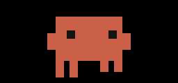
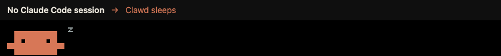
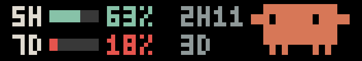
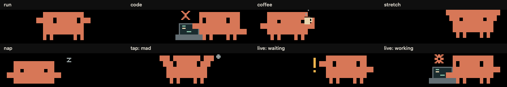

# Clawd for your Touch Bar

A little Clawd, running alongside your work.


Native [Pock](https://pock.app) widgets with the Claude Code mascot, redrawn on
the same half-block pixel grid as the terminal glyph: wide body, eyes as notches
cut into it, side arms and four one-pixel legs. Poses swap in discrete steps
instead of tweening, and Claude Code's `· ✢ ✳ ✶ ✻ ✽` spinner ticks while he codes.

**macOS 11+ · Pock 0.9 · Intel + Apple Silicon · no runtime dependencies**

## Two widgets

| | **Clawd** | **Clawd Live** |
|---|---|---|
| What drives him | His own schedule | What Claude Code is doing on this Mac |
| Tap Clawd | A 2.5 second tantrum | Your remaining usage limits |
| Bundle | `Clawd.pock` | `ClawdLive.pock` |

Both can sit on the Touch Bar at the same time.

### Clawd

He runs across the available space, stops to code, sips coffee, stretches with
a yawn, and curls up for a nap, on a fixed loop. Poke Clawd himself and he
throws a tiny tantrum before returning to exactly what he was doing. Tapping
the empty bar or his props does nothing.



### Clawd Live: what makes each state



*The captions are part of this demo, not the widget. Limits shown are sample numbers.*

Clawd Live reads `~/.claude/sessions/<pid>.json` once a second. Claude Code
(terminal, desktop app and IDE sessions alike) keeps one of these files per
running session with its live `status`. Files whose process has exited are
ignored. The busiest session wins:

| State | What triggers it | What Clawd does |
|---|---|---|
| **Waiting** | Any session's status is `waiting` (a permission prompt or a question for you) | Stops where he is, faces you and waves one arm, then the other, next to a blinking amber `!` |
| **Working** | Any session's status is `busy` (generating or running tools) | Runs to the right end, opens the laptop, types with both hands while the spinner ticks |
| **Idle** | No session busy or waiting, but one finished a turn in the last 5 minutes | Packs up and wanders through his usual loop: running, coffee, stretching |
| **Asleep** | No running session, or every session idle for over 5 minutes | Runs home to the left end and curls up to sleep, with a floating `z` |

Waiting outranks working, which outranks idle. A new state has to hold for
0.8 seconds before Clawd reacts, so brief flickers between tool calls do not
make him run back and forth. Changes are acted out, never cut: he finishes the
current action (closes the laptop, lowers the cup, wakes up), runs to where the
next one happens, then starts it.



**Tap Clawd** and he stops where he is to show the remaining 5-hour and 7-day limits for 4 seconds:
the label, a bar of what is left (green above 50%, amber above 20%, red below),
the percentage left, and the time until that window resets. On a narrow bar the
readout gets smaller, and below about 120 points it takes the whole strip. Tap
again to put it away.

**Where the limits come from.** Clawd Live never touches your Keychain or your
sign-in. On a tap it asks Claude Code itself: it runs the `claude` binary once,
non-interactively, with a one-word prompt to the cheapest model and no tools
(`claude -p ok --output-format stream-json --model haiku --max-turns 1 --tools ""
--no-session-persistence --setting-sources "" ...`). Claude Code answers with a
`rate_limit_event` carrying each window's utilization and reset time, from the
rate-limit headers of that one reply. Claude Code does its own sign-in and token
renewal, so nothing expires on the widget's side.

- **Cost:** one tiny request per check, roughly $0.0002 and about 3 seconds. Answers
  are reused for 5 minutes; a failed check is retried after 2.
- **While it runs:** the readout shows the Claude desktop app's own history
  (`~/Library/Application Support/Claude/plan-usage-history.json`) as a
  placeholder: percentages only, no reset times, and ignored once older than its
  window. Real numbers replace it as soon as the check lands.
- **Which binary:** `~/.local/bin/claude`, `~/.claude/local/claude`, Homebrew and
  `PATH` copies first, then the newest copy bundled inside the Claude desktop app.
- **Your sessions:** the check is itself a brief Claude session; Clawd Live
  recognises its own process and ignores it, so it never wakes him.
- **Optional:** the terminal CLI can also feed the readout live through its status
  line payload (`rate_limits`) with `setup-live.sh`, which costs no requests. The
  newest source wins.

If it can't show numbers it says why, in amber:

| Readout | Meaning |
|---|---|
| `NO CLAUDE` | No `claude` binary was found (install Claude Code or the desktop app) |
| `NO LOGIN` | Claude Code is not signed in |
| `NO LIMITS` | Claude answered but reported no plan limits (for example API-key billing) |
| `FAILED` | The check crashed, timed out after 25 seconds, or printed nothing usable |

The event format is part of Claude Code's streaming output, not a documented
promise, so a Claude Code update could change it.

Clawd Live makes no network requests of its own; the only traffic is the limits check that Claude Code itself performs. It reads files under `~/.claude` and the desktop app's usage history.

## Install

1. Download **Clawd.pock.zip** and/or **ClawdLive.pock.zip** from the [latest release](https://github.com/jurek-zsl/tb-clawd/releases/latest) and unzip them.
2. Open each extracted bundle with Pock and follow its installation prompt.
3. Quit and reopen Pock, choose **Customize Pock…** from its menu bar menu, and drag **Clawd** or **Clawd Live** onto your Touch Bar.
4. Tap Clawd Live for your limits. No permission prompts: it only needs Claude Code (or the Claude desktop app) installed.

If opening a bundle does not launch Pock's installer, put it in
`~/Library/Application Support/Pock/Widgets/`, then reopen Pock. Releases are
ad-hoc signed, not notarized; macOS may request approval when downloaded.

Clawd yields space to your other widgets, with a 64 point minimum. For the
whole bar, remove other widgets in Customize Pock and enable Pock's **Full
Width** layout if needed. Finger taps use Clawd's horizontal span because
Touch Bar touch geometry only provides a meaningful horizontal coordinate.

To uninstall, quit Pock and remove the bundle from that Widgets folder.

## Build from source

Requires Xcode command line tools. Pock is needed for the compatibility checks.

```sh
git clone https://github.com/jurek-zsl/tb-clawd.git
cd tb-clawd
./build.sh
./check.sh
./install.sh          # both; or: ./install.sh clawd, ./install.sh live
```

Both come from the same sources. The universal bundles are built at
`dist/Clawd.pock` and `dist/ClawdLive.pock`, with zips ready to share; the live
one is compiled with `CLAWD_LIVE=1` and renamed classes so Pock can load both.
`install.sh` keeps an existing copy with the same identifier as a timestamped
backup in `~/Library/Application Support/Pock/Clawd backups/` (outside the
Widgets folder, so Pock does not load it twice) and refuses to replace an
unrelated bundle. Reopen Pock after installing an update.

## Preview the little runner

```sh
./build/pock/ClawdTools --preview
./build/pock/ClawdTools --preview --live   # follows your real ~/.claude
```

The resizable native window uses the actual widget renderer and works on Macs
without a Touch Bar. Resize it to see Clawd adapt to the available space, and
poke the character to see his reaction. Add `--live` to watch Clawd Live
follow your real Claude Code sessions.



A deterministic schedule alternates four journeys with coding (10 seconds),
coffee (8 seconds), stretching (6 seconds), and napping (10 seconds). Each action
has a setup, held main action, and recovery: opening/typing/closing the laptop,
lifting/sipping/lowering the cup, gathering/stretching/yawning, and settling/
breathing/waking. Props stay attached and point toward the bar interior.

A direct poke pauses this schedule at Clawd's current location. His angry brow notches,
raised arms, shaking and little steam puff settle before the original action
resumes. Repeated pokes restart the reaction without moving him or advancing the
paused activity. The accessibility press action targets Clawd as well.

Clawd runs at 64 points per second with gentle acceleration at each end; his
leg cadence follows distance travelled. A 30 fps timer runs while the widget
is visible and pauses on removal, sleep, inactive user session or app hiding.

To regenerate everything in `docs/assets` from the built bundles:

```sh
./build.sh
./build/pock/ClawdTools --showcase docs/assets
```

The showcase uses the bundles' real renderers, with no redraws: cropping,
nearest-neighbour scaling and captions outside the strip only. `preview.gif`
is Clawd's full loop on a 420 point bar, `mad.gif` the tantrum close up,
`live.gif` Clawd Live driven by scripted session files, `limits.png` the
readout with sample numbers, and `actions-contact.png` every pose. GIFs are
written with ImageIO, so no Python or Pillow is needed.

## Verification

`check.sh` runs three suites. For Clawd Live it loads both bundles side by side
and drives the live view with real session files in a temporary directory:
busy, waiting, recently idle, long idle and exited-process sessions must produce
coding, waving, wandering and sleeping, reached by continuous running with no
jumps, at every width. Taps must show the limits readout (no data, healthy and
low bars), dismiss it, and time it out. It also checks that the status line
bridge saves only payloads with limits and chains a previous status line.

For Clawd, it loads the installed PockKit framework first, then checks the bundle's
principal class against its real `PKWidget` protocol. It verifies native layout
at widths 64, 176, 685 and 1000, complete travel, rendered bounds, stable running
speed, all four activities, continuous endpoint transitions, actor-only hits,
mad freeze/resume and repeated pokes, exact entry/recovery pixels, direct Touch
Bar handler dispatch using test events, indirect/empty/prop filtering, duplicate
mouse suppression, customization, lifecycle, sleep/wake, accessibility, object release,
both CPU architectures and code signing. Set `POCK_APP` if Pock is installed
outside `/Applications`. Physical Touch Bar presentation still needs a Touch
Bar Mac.

## Credits

Originally developed in [claudefm](https://github.com/jurek-zsl/claudefm).
Claude and Clawd belong to Anthropic; this is an unaffiliated community widget
with original code-drawn artwork, informed by the
[Claude Code storefront mascot](https://www.stickermule.com/claudecode/item/19156131).

Built against the public [PockKit widget protocol](https://github.com/pock/pockkit/blob/master/PockKit/Sources/Protocols/PKWidget.swift).
Pock supplies its own framework at runtime; no duplicate framework is bundled.
See [LICENSE](LICENSE), [NOTICE](NOTICE) and
[third-party notices](THIRD_PARTY_NOTICES.md).
