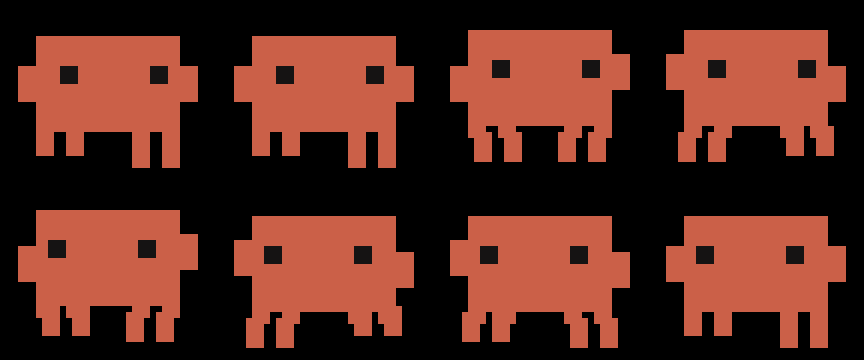

# Clawd for your Touch Bar

A little Clawd, running alongside your work.


A native [Pock](https://pock.app) widget with the Claude Code mascot's flat pixel
body, square eyes and four little legs. He runs across the available Touch Bar
space, blinks occasionally, and hops when you tap him.

**macOS 11+ · Pock 0.9 · Intel + Apple Silicon · no runtime dependencies**

## Install

1. Download **[Clawd.pock.zip from the latest release](https://github.com/jurek-zsl/tb-clawd/releases/latest)** and unzip it.
2. Open the extracted **Clawd.pock** bundle with Pock and follow its installation prompt.
3. Quit and reopen Pock, choose **Customize Pock…** from its menu bar menu, and drag **Clawd** onto your Touch Bar.

If opening the bundle does not launch Pock's installer, put `Clawd.pock` in
`~/Library/Application Support/Pock/Widgets/`, then reopen Pock. The release is
ad-hoc signed, not notarized; macOS may request approval when downloaded.

Clawd yields space to your other widgets, with a 64 point minimum. For the
whole bar, remove other widgets in Customize Pock and enable Pock's **Full
Width** layout if needed. Pock determines the final available width; the widget
does not change your layout or preferences.

To uninstall, quit Pock and remove `Clawd.pock` from that Widgets folder.

## Build from source

Requires Xcode command line tools. Pock is needed for the compatibility checks.

```sh
git clone https://github.com/jurek-zsl/tb-clawd.git
cd tb-clawd
./build.sh
./check.sh
./install.sh
```

The universal bundle is built at `dist/Clawd.pock`; `dist/Clawd.pock.zip` is ready
to share. `install.sh` installs only this widget and preserves an existing copy
with the same identifier as a timestamped backup. It refuses to replace an
unrelated bundle. Reopen Pock after installing an update.

## Preview the little runner

```sh
./build/pock/ClawdTools --preview
```

The resizable native window uses the actual widget renderer and works on Macs
without a Touch Bar. Resize it to see Clawd adapt to the available space, and
click to make him hop.



Clawd runs at 64 points per second with gentle acceleration at each end; his
leg cadence follows distance travelled. A 30 fps timer runs while the widget
is visible and pauses on removal, sleep, inactive user session or app hiding.

To regenerate previews, Pillow is an optional development dependency:

```sh
./build/pock/ClawdTools --export build/pock/frames-v1.1
python3 -m venv build/pock/preview-venv
build/pock/preview-venv/bin/python -m pip install Pillow
build/pock/preview-venv/bin/python Tools/make_preview.py
```

Export records a complete journey along a 685 point strip. Add a width argument,
such as `--export build/pock/frames-1000 1000`, to capture another allocation.
The Python script assembles AppKit-rendered PNGs into the GIF and contact sheets
in `dist/`; it does not redraw the mascot.

## Verification

`check.sh` loads the installed PockKit framework first, then checks the bundle's
principal class against its real `PKWidget` protocol. It verifies native layout
at widths 64, 176, 685 and 1000, complete travel, rendered bounds, stable running
speed, customization, lifecycle, sleep/wake, accessible hop, object release,
both CPU architectures and code signing. Set `POCK_APP` if Pock is installed
outside `/Applications`. Physical Touch Bar presentation still needs a Touch
Bar Mac.

## Credits

Originally developed in [claudefm](https://github.com/jurek-zsl/claudefm).
Claude and Clawd belong to Anthropic; this is an unaffiliated community widget
with original code-drawn artwork, informed by the
[Claude Code storefront mascot](https://www.stickermule.com/claudecode/item/19156131).

Built against the public [PockKit widget protocol](https://github.com/pock/pockkit/blob/master/PockKit/Sources/Protocols/PKWidget.swift).
Pock supplies its own framework at runtime; no duplicate framework is bundled.
See [LICENSE](LICENSE), [NOTICE](NOTICE) and
[third-party notices](THIRD_PARTY_NOTICES.md).
